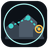

<p align="center"></p>
<h1 align="center">Rooftop Lens</h1>
<p align="center">Find the rooftop Agility camera view that keeps your clicks closest together.</p>

Rooftop Lens watches your laps. Each lap you finish without moving the camera is filed under that camera view,
along with where you clicked each obstacle. A view's score is the distance your mouse travels from obstacle to
obstacle for one lap. The shortest route wins. Distances are measured relative to the game's projection, so
resizing the window or zooming doesn't change them, and zoom isn't part of a view.

The plugin never moves the camera, mouse, or character, and never clicks for you. Everything is stored in your
local RuneLite config.

## Using it

1. Go to a rooftop course. A card in RuneLite's overlay style appears with the course name and your lap
   progress.
2. Follow the viewfinder: the orange ring sits where the camera should point. It sits left or right for rotation
   and up or down for tilt. The text says the same thing in words. **Try this view** is a view you haven't lapped
   yet: the four quarter turns, then 45° and 22.5° either side of the best one. **Best view** is your shortest
   route so far. Views are compared at the pitch of your latest lap, so if you tilt away the card asks you to tilt
   back. Once every view the search wants has a lap, the card asks for **3 laps** on the best view to
   confirm it, so one lucky lap can't win, and then says **Calibrated**. When you're on the view,
   the ring centers and turns green.
3. Run a lap from the first obstacle to the last without touching the camera. While a lap runs, the card holds
   the view you started in. A step counts when its Agility XP lands, so clicking the next obstacle too early,
   while the game ignores it, doesn't skip ahead. A finished lap shows **Lap learned**. If the camera leaves that
   view before your last click, the card shows **Camera moved, lap dropped**; the next lap starts when you click
   the first obstacle again. Camera pitch above the game's standard limit counts as the limit, because the game
   pulls expanded pitch back there mid-course.
4. After a lap, the screen shows where each obstacle will be when you usually click it: a ring on the next one,
   and a dashed line to the one after. The ring stays fixed on screen while the camera follows you, so you can
   move the mouse there during the animation. It's amber while the current obstacle runs and turns green when its
   XP lands and your click will count. Spots are learned per view and camera pitch, and hold at any zoom and
   window size.

The next obstacle is filled amber. Other obstacles are outlined in teal with their step number.

## Settings

| Setting | Default | What it does |
| --- | --- | --- |
| Show click spots | on | Mark the screen spot where you usually click each obstacle, in views you've lapped |
| Outline every obstacle | on | Outline all visible obstacles and show every click spot, not only the next two |
| Next obstacle | amber | Color of the obstacle to click next |
| Click now | green | Color of the next click spot once your click will count |
| Other obstacles | teal | Color of other obstacles and their click spots |

## Courses

Draynor Village, Al Kharid, Varrock, Canifis, Falador, Seers' Village, Pollnivneach, Rellekka, Ardougne.

## Credits

Rooftop Lens is a fork and rewrite of [Rooftop Camera Planner](https://github.com/MichaelRVP/rooftop-camera-planner)
by MVP IT Solutions ([MichaelRVP](https://github.com/MichaelRVP)). That project came up with the idea of learning
a low-travel camera view from your laps and marking the click route, and its course table is carried over here.
Course data traces back to RuneLite's Agility plugin. See [THIRD_PARTY_NOTICES.md](THIRD_PARTY_NOTICES.md).

## License

[BSD 2-Clause](LICENSE). The original copyright notice from Rooftop Camera Planner is kept alongside this fork's.

## Development

```
./gradlew test        # unit tests
./gradlew run         # RuneLite dev client with the plugin loaded
```
